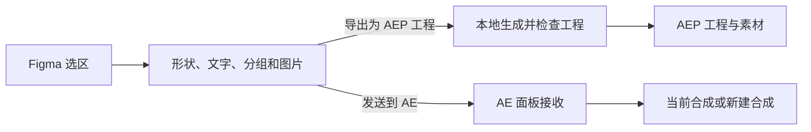

# F2A · Figma to After Effects

**把 Figma 设计变成可以继续做动效的 AE 图层。** 从一个画框生成独立的 `.aep`，也可以只发送选中的几个图层，直接接到正在制作的合成里。

[**下载 Windows 版**](https://github.com/TelosmaYLX/Figma2Ae/releases/latest) · [快速开始](#快速开始) · [在 OpenPencil 中使用](#在-openpencil-中使用) · [工作原理](#工作原理) · [图层转换](#图层转换) · [MCP](#用-mcp-操作-figma-和-ae)

| 你想做什么 | 在 Figma 中选择 | 得到的结果 |
| --- | --- | --- |
| 交付一个页面，或从设计稿开始做动效 | **导出为 AEP 工程** | 独立工程和配套素材，可指定 AE 2024、2025 或 2026 |
| 把按钮、标题或组件送到 AE | **发送到 After Effects** | 加入活动合成，或按选区自动新建合成 |
| 直接输出像素级前端网页 | **导出为 HTML 网页** | 独立的 `index.html` + `style.css` + `main.js` + `assets/` 静态页面，无需 AE/Python |

## 快速开始

需要 **Windows x64**、Figma 桌面版和 After Effects。将 **Node.js 20+** 和 **Python 3.11+** 的 64 位版本加入 `PATH`，安装 Python 时保留 pip、venv 和 Tcl/Tk。首次安装需要联网下载 AEP 依赖。

1. 下载 `F2A-Windows-x64-v<版本号>.zip` 并完整解压。[下载最新版](https://github.com/TelosmaYLX/Figma2Ae/releases/latest)
2. 关闭 AE，双击 `install.cmd`。默认安装到 `%APPDATA%\Adobe\CEP\extensions\F2A`。窗口会显示 Skill 同步目录，可以按提示配置 MCP 或回车跳过。
3. 在 Figma 桌面版打开「插件 → 开发」，从 manifest 导入安装程序显示的 `figma-plugin/manifest.json`，然后打开 F2A。
4. 在 AE 打开「窗口 → 扩展 → F2A」。Figma 面板显示「已连接到 After Effects」后即可使用。

已有系统级安装时，用管理员 PowerShell 将新版安装到原目录。其他安装选项见 [Windows 安装说明](scripts/distribution/INSTALL.md)。

开发时可直接从工作区导入 `figma-plugin/manifest.json`。Figma 中显示「F2A 工作区开发版」。在仓库目录运行 `node scripts/aep-server.cjs --workspace` 后，开发版的「导出为 AEP 工程」使用当前工作区的写入器。

```powershell
.\install.cmd -InstallDirectory "C:\Program Files (x86)\Common Files\Adobe\CEP\extensions\F2A"
```

## 在 OpenPencil 中使用

F2A 现已原生适配开源设计工具 **OpenPencil** 桌面端（无需修改或重编 OpenPencil），复用 OpenPencil 内置的本地自动化 RPC（自动读取系统目录中的 `OpenPencil/mcp.json`）与 F2A 完整转换管线：

- **前提**：在 OpenPencil 桌面端打开设计稿，并确认 **Settings → MCP → Local server** 已开启，且**关闭**了“Share only the selection（仅共享选区）”选项。
- **文字模式提示**：OpenPencil 的文字转矢量依赖本机已安装对应字体；若导入的 `.fig` 包含未安装字体，可在面板中切换为 **可编辑文字** 或 **PNG 图片** 模式（或安装对应字体后再转矢量）。
- **方式一：直接在 AE 的 F2A 面板中使用（最省心，零手动跑脚本）**
  - 打开 After Effects 的「窗口 → 扩展 → F2A」后，面板会自动在后台拉起 OpenPencil 桥接服务。
  - 点击面板顶部的 **OpenPencil** 标签页，即可在 AE 面板内部直接使用完整 F2A 导出功能（支持切换文档、发送到当前合成、导出 AEP/HTML、图层工具、错误定位图层）；单屏场景下也可以直接点右侧 **弹出小窗**，分离出独立置顶浮窗贴在 OpenPencil 旁边操作。
- **方式二：独立小浮窗面板（不开 AE 时也能单独导出 AEP / HTML，不进入默认浏览器）**
  - 双击 `openpencil/start-panel.cmd`（无黑框后台启动，关闭小窗后自动退出），或运行 `node scripts/openpencil-panel.cjs`。
  - 会通过本机 Edge/Chrome 的 `--app=` 应用模式 + 独立 profile 弹出约 `360×840` 的**无地址栏独立小窗**，不打扰你日常使用的默认浏览器；Windows 下默认自动**置顶**（顶部可一键切换「置顶 / 已置顶」），方便贴在 OpenPencil 旁边并排选图层操作。
  - 可选参数：`--no-topmost`（默认不置顶）、`--browser`（改在默认浏览器标签页打开）、`--workspace`（优先连接 `17366` 端口开发导出服务）、`--headless`（无窗口后台接入 F2A MCP）。
- **方式三：命令行直接导出（适合批处理与脚本集成）**
  ```bash
  # 查看 OpenPencil 连接状态、已打开文档和当前选区
  node scripts/openpencil-export.cjs --list-documents

  # 将当前选区导出为独立 AEP 工程（默认）或 HTML 网页
  node scripts/openpencil-export.cjs --format aep --output ./out-aep
  node scripts/openpencil-export.cjs --format web --output ./out-web

  # 按图层 ID 指定导出目标，或直接发送到已打开的 After Effects
  node scripts/openpencil-export.cjs --format ae --node 1:1549
  node scripts/openpencil-export.cjs --format web --node 1:1549 --text-mode vector -o ./out-web
  ```

## 工作原理

F2A 读取选中的画框和图层，在临时副本上提取形状、文字、分组和图片。两条路径都在本机处理。导出结果带有默认隐藏的「原图对照」层，可在 AE 中打开它，对照 Figma 原稿检查位置和外观。



### 导出独立 AEP

1. 在 Figma 选中要交付的画框或图层。
2. 在 **发送到 After Effects** 下方的合成参数面板中设置合成时长、帧率和目标 AE 版本。帧率默认 30 fps，时长默认 10 秒；AE 2024 对应 `24.x`，2025 对应 `25.x`，2026 对应 `26.x`（默认）。
3. 点击面板底部的 **导出为 AEP 工程**。本地服务先生成并检查工程，再打开保存窗口，让你选择保存位置和工程名。

面板会记住上次使用的全部参数，下次打开 F2A 时沿用，不需要重新调整。

保存后会得到一个同名文件夹，包含 `.aep`、`Assets/` 素材和 `report.json` 导出报告。在 AE 中打开 `.aep` 即可开始制作。移动或交付时请带上整个文件夹。

### 导出像素级 HTML + CSS + JS 网页（形态 A）

1. 启动本地导出服务（仓库开发模式运行 `node scripts/aep-server.cjs --workspace`，或使用已更新的 F2A 服务）。
2. 在 Figma 选中画框或图层，点击 **导出为 HTML 网页**，选择保存文件夹即可输出纯净的像素级静态前端项目（`index.html`、`style.css`、`main.js`、`layers.json`、`assets/`）。
3. 点击 **浏览器预览** 或直接双击 `index.html` 即可打开（支持 `file://` 本地直接预览，无需启动开发服务器）：
   - 按 `Shift+I`（或在网址后加 `?inspector=1`）打开内置调试条，支持 **原图对照**、**差值比对**、**图层框高亮**、**1:1 像素切换**；
   - 也支持命令行直接转换：`node scripts/export-web.cjs packet.json output-dir`。

### 把图层送入当前合成

在 Figma 选中图层，点击 **发送到 After Effects**。F2A 优先导入 AE 的活动合成。首次导入时，按提示设置 **图片保存位置**，用于存放 AE 引用的图片素材。

AE 没有活动合成时，F2A 按选区包围框新建合成，多选会保留图层间的相对位置。单选 Frame 或选区有共同的 `[root]` 基准画框时，使用画框的名称和尺寸。新合成沿用合成参数面板中的时长和帧率。

### 用 `[root]` 保留局部图层的位置

比如你只想把页面里的按钮送入 AE，希望它仍位于离页面左上角 120 px、80 px 的位置。先选中页面 Frame，在 **图层工具** 中点 **标记基准画框**，然后选中按钮并点击 **发送到 After Effects**。F2A 使用 `[root]` 画框的左上角作为定位原点，发送的图层仍保持各自的相对位置。

- 标记嵌套时，单选使用最近的一层 `[root]`，多选使用最近的共同 `[root]`。
- 整个选区都没有基准标记时，使用选区左上角定位。有基准标记但找不到共同基准时，F2A 会提示重新选择。
- 选中画框并点击 **取消基准标记**，即可移除名称前的 `[root]`。基准标记用于 **发送到 After Effects**。

## 图层转换

| 设置 | 转换逻辑 |
| --- | --- |
| **保留分组层级** | 将 Figma 分组转换成 AE 预合成，组内元素可以继续单独做动效。 |
| **单图层嵌套预合成** | 默认开启。为每个单图层（文字、形状、图片、画框底色等）外层单独嵌套一个同名预合成，尺寸按该图层边界对齐，并以黄色图层标记最小合成。 |
| **保留画框裁剪** | 按 Figma 画框的裁剪范围限制内容显示。 |
| **矢量形状（无需字体）** | 默认文字模式。把字形转换成 AE 形状，可以编辑路径和填充。 |
| **可编辑文字** | 创建可修改内容的 AE 文字图层。请在本机安装对应字体和字重。 |
| **PNG 图片** | 把文字作为图片输出，用于保留 Figma 中的文字外观。 |
| **标记为图片** | 在图层名前加 `*`，将该图层或图层组输出为 PNG，适合需要保留外观的局部复杂效果。 |
| **矢量图形转图片** | 在「高级选项 → 强制转为图片」勾选「矢量图形」，按切图倍率将形状和路径输出为 PNG。文字和图片沿用各自的导出设置。 |
| **图片蒙版** | 默认保留原图和独立蒙版。选择 **合并成图片** 时，会输出应用蒙版后的图片。 |
| **切图倍率** | 在 `1×` 到 `4×` 之间调整栅格化图片的分辨率。 |
| **保留图片调色属性** | 用 **Figma 调色** AE 效果在图片外层预合成上复原曝光、对比度等七项数值，可在「效果控件」中调整或打关键帧。安装或更新时会自动装到 AE CC 2019+ 的插件目录；缺失时首次导出再试一次，仍不可用才退回内置 LUT 调色。 |

高级选项可按类别允许 F2A 将复杂效果转成图片，例如模糊、特殊填充和部分蒙版。其余能转换为 AE 原生图层的内容仍可继续编辑。

## 在 AE 中更新

打开 AE 的 F2A 面板时会自动检查一次更新，有新版时会显示提醒。也可手动点 **检查更新**。发现新版后，点击 `更新到 <版本号>` 安装，然后重新打开 AE 和 Figma 的 F2A 面板。

发现新版时，点击「有可用更新」可查看 GitHub Release 的发布说明。手动检查发现新版会自动展开，安装完成后该栏自动隐藏。

安装和更新按发布清单同步 CEP 扩展和 Skill。新增文件会补齐，上一版由 F2A 安装、这版已移除的文件会清理。安装或更新时还会尝试把 **Figma 调色** 插件复制到本机 AE CC 2019 及以上版本的 `Plug-ins\F2A`（没有写权限时只提示，首次导出前再试一次），复制后重启 AE 生效。

如果 v1.1.0 检查更新报 `listener` 错误，下载新版 ZIP 并按安装步骤覆盖原安装目录。该错误已在 v1.1.1 修复。[下载最新版](https://github.com/TelosmaYLX/Figma2Ae/releases/latest)

## 用 MCP 操作 Figma 和 AE

在 Figma 选中画框并打开 F2A，agent 可以通过 `f2a` 导出选区、应用 AE Motion 动效预设、保存可编辑的 AEP，再渲染 H.264 MP4。首次使用 AE 工具时，按提示重启 AE 以加载扩展。 [配置和使用 MCP](mcp/README.md)

也可以把 AE 里手调好的关键帧保存为动效配方，再套用到其他工程的图层。 [复用手调动效](mcp/README.md#复用手调动效)

F2A 面板的 **内置动效** 除模板抽取片段与参数化预设外，还包含从 [React Bits](https://reactbits.dev)、[Aceternity UI](https://ui.aceternity.com)、[Animate UI](https://animate-ui.com)、[Osmo](https://www.osmo.supply) 与 [video-shotcraft](https://github.com/Vincentwei1021/video-shotcraft) 的入场/文字/转场动画提炼的 `RB`、`AC`、`AU`、`OS`、`SC` 预设与片段（power/expo/back/quint 曲线、逐字/逐词错峰、单段弹簧过冲；转场含渐隐、对擦、合幕与白闪）。文字预设走 AE 文字动画器＋单条表达式，仅适合 AE/视频输出；Web/Lottie 交付优先使用 `rb-content-*`、`ac-modal-pop`、`au-effect` 等无表达式片段。可移植性分析与映射见 `skills/f2a-motion-production/references/` 下的 `reactbits-motion-vocabulary.md`、`aceternity-motion-vocabulary.md`、`animate-ui-motion-vocabulary.md`、`osmo-motion-vocabulary.md` 与 `video-shotcraft-motion-vocabulary.md`。

## 常见问题

- **AEP 导出提示字体或字形缺失？** 可编辑文字依赖导出器识别实际字体和字重。若只是要保留外观和形状动画，选择 **矢量形状（无需字体）** 后重新导出。
- **导出失败后如何找到图层？** 提示旁出现 **定位图层** 时，点击即可在 Figma 中选中对应图层。导出成功后的转换信息可在工程文件夹里的 `report.json` 查看。
- **子图层怎样落在原来的页面位置？** 选中承载整张页面的 Frame，标记为 `[root]`，再选中子图层发送。若内部 Frame 也有标记，先取消内层标记，让子图层按页面定位。
