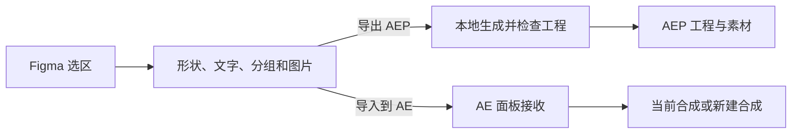

# F2A · Figma to After Effects

**把 Figma 设计变成可以继续做动效的 AE 图层。** 从一个画框生成独立的 `.aep`，也可以只发送选中的几个图层，直接接到正在制作的合成里。

[**下载 Windows 版**](https://github.com/TelosmaYLX/Figma2Ae/releases/latest) · [快速开始](#快速开始) · [工作原理](#工作原理) · [图层转换](#图层转换) · [MCP](#用-mcp-操作-figma)

| 你想做什么 | 在 Figma 中选择 | 在 AE 中得到 |
| --- | --- | --- |
| 交付一个页面，或从设计稿开始做动效 | **导出 AEP（推荐）** | 独立工程和配套素材，可指定 AE 2024、2025 或 2026 |
| 给正在制作的合成补一个按钮、标题或组件 | **导入到 After Effects** | 选区图层加入活动合成，也可按画框尺寸自动建合成 |

## 快速开始

需要 **Windows x64**、Figma 桌面版和 After Effects。将 **Node.js 20+** 和 **Python 3.11+** 的 64 位版本加入 `PATH`，安装 Python 时保留 pip、venv 和 Tcl/Tk。首次安装需要联网下载 AEP 依赖。

1. 登录有仓库读取权限的 GitHub 账号，下载 `F2A-Windows-x64-v<版本号>.zip` 并完整解压。[下载最新版](https://github.com/TelosmaYLX/Figma2Ae/releases/latest)
2. 关闭 AE，双击 `install.cmd`。默认安装到 `%APPDATA%\Adobe\CEP\extensions\F2A`。
3. 在 Figma 桌面版打开「插件 → 开发」，从 manifest 导入安装程序显示的 `figma-plugin/manifest.json`，然后打开 F2A。
4. 在 AE 打开「窗口 → 扩展 → F2A」。Figma 面板显示「已连接到 After Effects」后即可使用。

已有系统级安装时，用管理员 PowerShell 将新版安装到原目录。其他安装选项见 [Windows 安装说明](scripts/distribution/INSTALL.md)。

```powershell
.\install.cmd -InstallDirectory "C:\Program Files (x86)\Common Files\Adobe\CEP\extensions\F2A"
```

## 工作原理

F2A 读取选中的画框和图层，在临时副本上提取形状、文字、分组和图片。两条路径都在本机处理。导出结果带有默认隐藏的「原图对照」层，可在 AE 中打开它，对照 Figma 原稿检查位置和外观。



### 导出独立 AEP

1. 在 Figma 选中要交付的画框或图层。
2. 在 **导出 AEP（推荐）** 右侧选择目标 AE 版本。AE 2024 对应 `24.x`，2025 对应 `25.x`，2026 对应 `26.x`（默认）。
3. 点击 **导出 AEP（推荐）**。本地服务先生成并检查工程，再打开保存窗口，让你选择保存位置和工程名。

保存后会得到一个同名文件夹，包含 `.aep`、`Assets/` 素材和 `report.json` 导出报告。在 AE 中打开 `.aep` 即可开始制作。移动或交付时请带上整个文件夹。

### 把图层送入当前合成

先在 AE 打开目标合成，再在 Figma 选中要发送的图层，点击 **导入到 After Effects**。首次导入时，按提示设置 **图片保存位置**，用于存放 AE 引用的图片素材。

如果 AE 没有活动合成，F2A 会在单选一个 Frame 或选区有共同基准画框时，按该画框的名称和尺寸新建合成。

### 用 `[root]` 保留局部图层的位置

比如你只想把页面里的按钮送入 AE，希望它仍位于离页面左上角 120 px、80 px 的位置。先选中页面 Frame，在 **图层工具** 中点 **标记基准画框**，然后选中按钮并点击 **导入到 After Effects**。F2A 使用 `[root]` 画框的左上角作为定位原点，发送的图层仍保持各自的相对位置。

- 标记嵌套时，单选使用最近的一层 `[root]`，多选使用最近的共同 `[root]`。
- 整个选区都没有基准标记时，使用选区左上角定位。有基准标记但找不到共同基准时，F2A 会提示重新选择。
- 选中画框并点击 **取消基准标记**，即可移除名称前的 `[root]`。基准标记用于 **导入到 After Effects**。

## 图层转换

| 设置 | 转换逻辑 |
| --- | --- |
| **保留分组层级** | 将 Figma 分组转换成 AE 预合成，组内元素可以继续单独做动效。 |
| **保留画框裁剪** | 按 Figma 画框的裁剪范围限制内容显示。 |
| **矢量形状（无需字体）** | 默认文字模式。把字形转换成 AE 形状，可以编辑路径和填充。 |
| **可编辑文字** | 创建可修改内容的 AE 文字图层。请在本机安装对应字体和字重。 |
| **PNG 图片** | 把文字作为图片输出，用于保留 Figma 中的文字外观。 |
| **标记为图片** | 在图层名前加 `*`，将该图层或图层组输出为 PNG，适合需要保留外观的局部复杂效果。 |
| **图片蒙版** | 默认保留原图和独立蒙版。选择 **合并成图片** 时，会输出应用蒙版后的图片。 |
| **切图倍率** | 在 `1×` 到 `4×` 之间调整栅格化图片的分辨率。 |

高级选项可按类别允许 F2A 将复杂效果转成图片，例如模糊、特殊填充和部分蒙版。其余能转换为 AE 原生图层的内容仍可继续编辑。

## 在 AE 中更新

打开 AE 的 F2A 面板时会自动检查一次更新，有新版时会显示提醒。也可手动点 **检查更新**。发现新版后，点击 `更新到 <版本号>` 安装，然后重新打开 AE 和 Figma 的 F2A 面板。私有仓库通过 Git for Windows 的 Git Credential Manager 登录。

如果 v1.1.0 检查更新报 `listener` 错误，下载新版 ZIP 并按安装步骤覆盖原安装目录。该错误已在 v1.1.1 修复。[下载最新版](https://github.com/TelosmaYLX/Figma2Ae/releases/latest)

## 用 MCP 操作 Figma

F2A 也可作为 MCP 服务。注册 `f2a` 并打开 Figma 面板后，支持 MCP 的客户端可以读取选区、查找和重命名图层、编辑设计节点或获取截图。仅使用 MCP 时，可以只启动 Figma。[配置 MCP](mcp/README.md)

## 常见问题

- **AEP 导出提示字体或字形缺失？** 可编辑文字依赖导出器识别实际字体和字重。若只是要保留外观和形状动画，选择 **矢量形状（无需字体）** 后重新导出。
- **导出失败后如何找到图层？** 提示旁出现 **定位图层** 时，点击即可在 Figma 中选中对应图层。导出成功后的转换信息可在工程文件夹里的 `report.json` 查看。
- **子图层怎样落在原来的页面位置？** 选中承载整张页面的 Frame，标记为 `[root]`，再选中子图层发送。若内部 Frame 也有标记，先取消内层标记，让子图层按页面定位。
